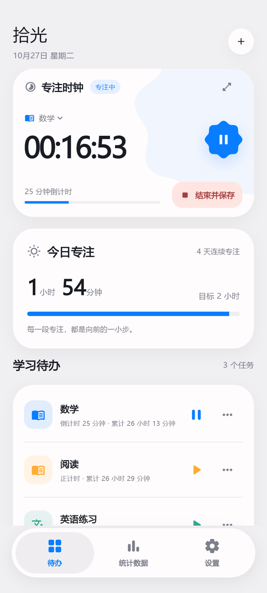
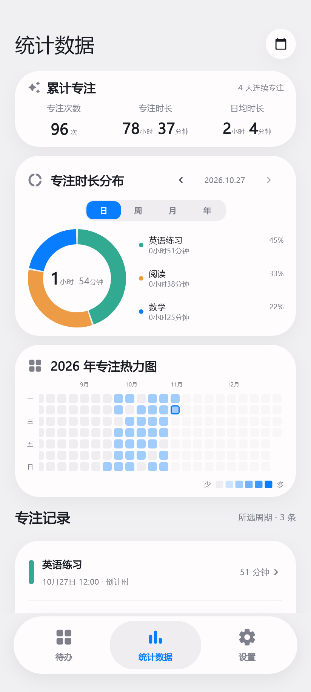
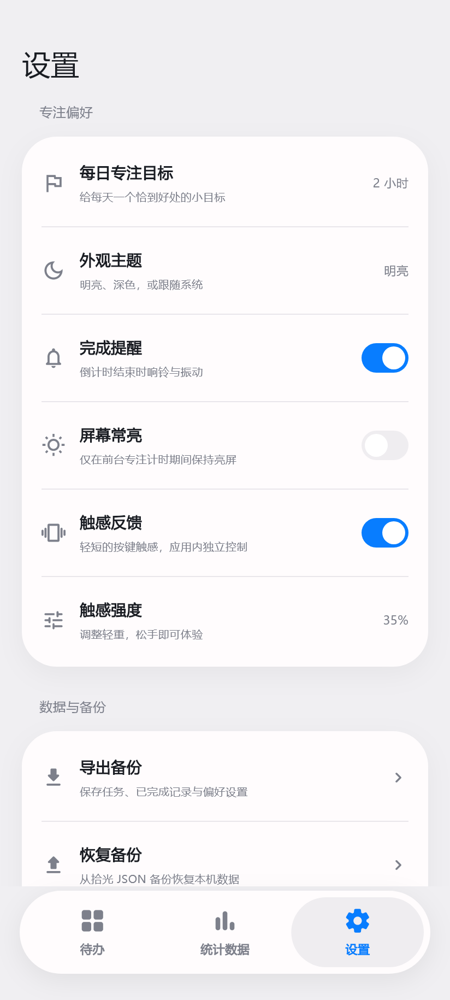
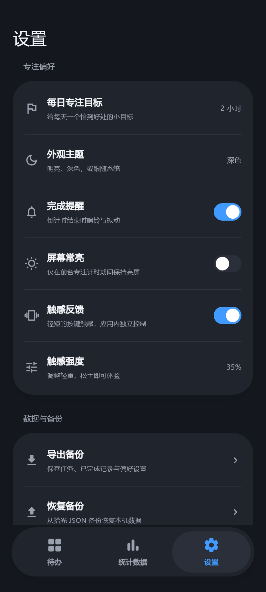
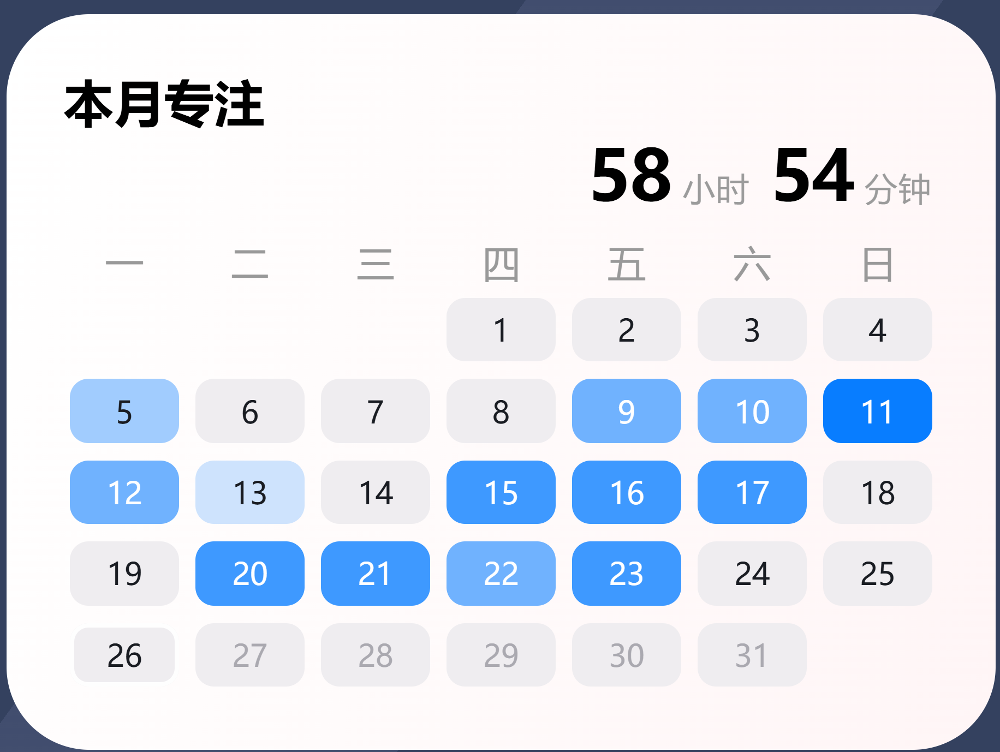

<div align="center">

# 拾光 · FocusClock

把时间，留给重要的事。

一个离线的 Android 学习计时 App，记录每一段专注，看到自己的积累。

**Android 8.0+ · Flutter / Dart + Java · v2.1.6**

</div>

## 界面预览

浅灰底色、大圆角卡片与蓝色操作按钮，围绕待办、统计数据和设置三个页面展开。

| 待办与专注计时 | 统计数据 | 设置 |
| :---: | :---: | :---: |
|  |  |  |

以上图片由实际 Flutter 页面渲染，使用演示任务与记录，不代表真实用户数据。点击图片可以查看大图。

<details>
<summary>查看深色主题</summary>

<p align="center">
  
</p>

</details>

### 桌面月热力图

无需打开 App，即可查看本月累计时长与每天的专注情况。

<p align="center">
  
</p>

小部件图片为布局示意，时长与日期均为演示数据；实际显示会随桌面分配的尺寸、字体及主题调整。

## 主要功能

- **任务与计时**：自由添加、编辑和完成学习任务，为每个任务设置正计时或倒计时，支持暂停、继续、结束保存及沉浸时钟。
- **专注统计**：累计次数、专注时长、日均时长、连续专注天数，以及按日／周／月／年查看的任务分布和专注记录。
- **饼图与热力图**：时长以“X小时X分钟”展示；饼图中心突出小时，旁侧列表在普通字号下完整展示三个任务，更多任务可滚动查看。
- **Android 桌面小部件**：默认 3×2，每行一周，显示本月累计时长与日期热力；点击日期可进入对应日的统计页面。
- **个性化体验**：明亮／深色／跟随系统主题、启停与页面切换动效、应用内触感开关及 1–100% 强度调节。
- **每日目标与备份**：以小时设置每日目标，支持小数；支持 JSON 备份恢复与 CSV 导出。

## 统计规则

- 新计时的有效专注时长需 **超过 10 秒**才生成记录；暂停时间不累计。
- 跨日记录按实际专注片段分配时长，累计次数仅计算一次。
- 日均时长从首次记录日至今按自然日计算，包含未专注的日期。
- 日期与跨日统计统一使用 **北京时间（UTC+8）**，周从周一开始。
- 每日目标以小时编辑，内部保存为整数分钟；原有目标可继续使用。

热力颜色由浅到深，对应以下每日专注时长：

| 档位 | 专注时长 |
| --- | --- |
| 空白色 | 0 |
| 第一档 | 大于 0、不足 1 小时 |
| 第二档 | 1 小时 ≤ 时长 < 3 小时 |
| 第三档 | 3 小时 ≤ 时长 < 6 小时 |
| 第四档 | 6 小时 ≤ 时长 < 8 小时 |
| 第五档 | 8 小时及以上 |

## 本地数据与后台计时

任务、偏好和专注记录保存在设备本地。正式版本无需账号、无广告，也不申请网络权限。JSON 备份和 CSV 导出由用户通过系统文件选择器保存。

后台计时由 Android 原生前台服务维护，通知栏支持暂停、继续和结束操作。部分设备需要允许通知及后台运行；触感、提醒和小部件刷新仍会受到硬件能力、省电与系统策略影响。

覆盖安装需要保持相同包名与签名。卸载或清除数据会移除本地记录，重要记录可先导出备份。

## 技术架构

界面使用 **Dart + Flutter Widgets** 构建，通过 **MethodChannel** 调用 Android 原生能力。后台计时、持久存储、通知、触感和桌面小部件由 **Java** 实现。

| 模块 | 主要职责 |
| --- | --- |
| [lib/main.dart](lib/main.dart)、[lib/ui.dart](lib/ui.dart) | 应用入口、主题、导航与通用组件 |
| [lib/tasks.dart](lib/tasks.dart)、[lib/focus_toggle.dart](lib/focus_toggle.dart) | 任务、专注时钟与启停动效 |
| [lib/stats_page.dart](lib/stats_page.dart)、[lib/statistics.dart](lib/statistics.dart) | 专注统计、任务分布与年度热力图 |
| [lib/settings_page.dart](lib/settings_page.dart) | 每日目标、主题、触感及数据管理 |
| [lib/controller.dart](lib/controller.dart)、[lib/models.dart](lib/models.dart) | 状态、数据模型与原生通信 |
| [Android 原生模块](android/app/src/main/java/com/shiguang/focus) | 可靠计时、存储、通知、文件读写、触感与月热力小部件 |
| [test](test) | Flutter 统计、控制逻辑和页面交互测试 |
| [tool](tool) | 页面预览渲染与原生逻辑检查工具 |

运行时仅依赖 Flutter SDK 与 Android 系统能力。

## 本地开发

已验证的开发环境：

| 工具 | 版本 |
| --- | --- |
| Flutter / Dart | 3.47.8 / 3.13.7 |
| JDK | 17 |
| Android SDK / Build Tools | API 36 / 35.0.0 |
| Android 最低版本 / 目标 API | Android 8.0（API 26）/ API 35 |

克隆工程并安装依赖：

```sh
git clone https://github.com/xingxiangzi314/FocusClock.git
cd FocusClock
flutter pub get
```

### 在 VS Code 预览 UI

安装 Flutter 与 Dart 扩展，打开 [lib/ui_previews.dart](lib/ui_previews.dart)，在命令面板执行 **Flutter: Show Widget Preview**。

预览包含待办、统计数据和设置页面，使用内存演示数据，**无需手机或模拟器**。修改页面后保存即可预览；后台计时、通知、触感与桌面小部件需在 Android 设备中体验。

### 检查与测试

```sh
flutter analyze
flutter test
```

2.1.6 已通过 43 项 Flutter 自动化测试，覆盖统计分摊、目标换算、任务操作、主题、动效与页面布局。原生检查工具位于 `tool/test_*_native.py`；运行它们还需 Python、JDK、Android SDK 及对应测试依赖，详见各脚本。

### 运行与构建 Android

工程的签名配置读取 `signing/debug.keystore`，密钥文件不随仓库上传。已有本地开发密钥时直接复用；首次克隆可在 PowerShell 中生成自己的开发密钥（需将 JDK 的 `keytool` 加入 PATH）：

```powershell
New-Item -ItemType Directory -Force signing | Out-Null
keytool -genkeypair -keystore signing/debug.keystore -alias androiddebugkey -storepass android -keypass android -keyalg RSA -keysize 2048 -validity 10000 -dname "CN=FocusClock Local Development"
```

然后连接 Android 手机或启动模拟器：

```sh
flutter run
```

构建 ARM32 + ARM64 通用 APK：

```sh
flutter build apk --release --target-platform android-arm,android-arm64
```

安装包生成于 `build/app/outputs/flutter-apk/app-release.apk`。自行生成的签名用于本地开发，覆盖已有安装时需使用相同证书。

## 反馈

欢迎通过 [Issues](https://github.com/xingxiangzi314/FocusClock/issues) 提交问题或功能建议。界面问题可附截图；计时、通知或小部件问题，请说明手机型号、Android／系统版本、App 版本及复现步骤。
